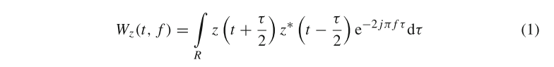
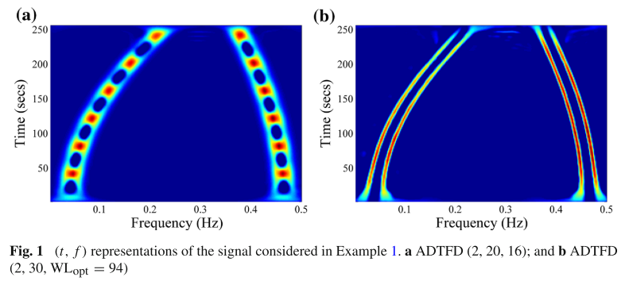
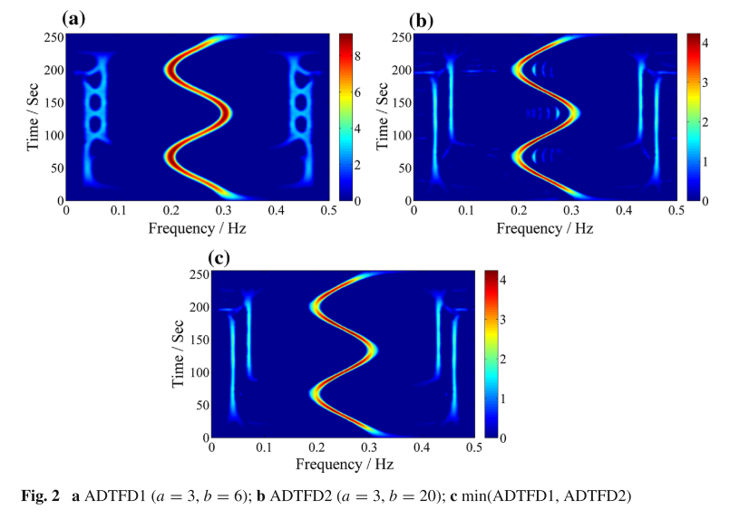
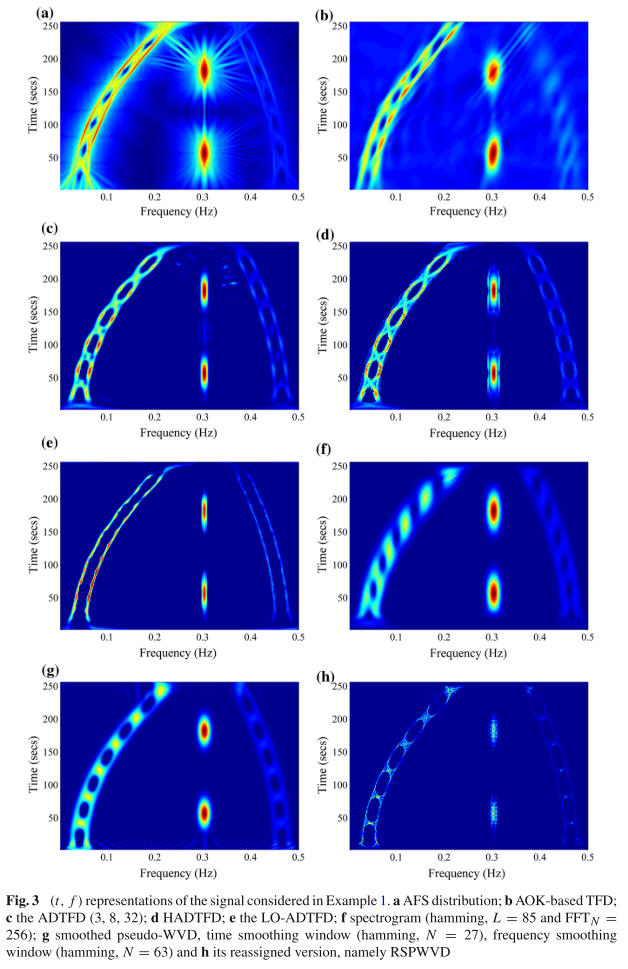
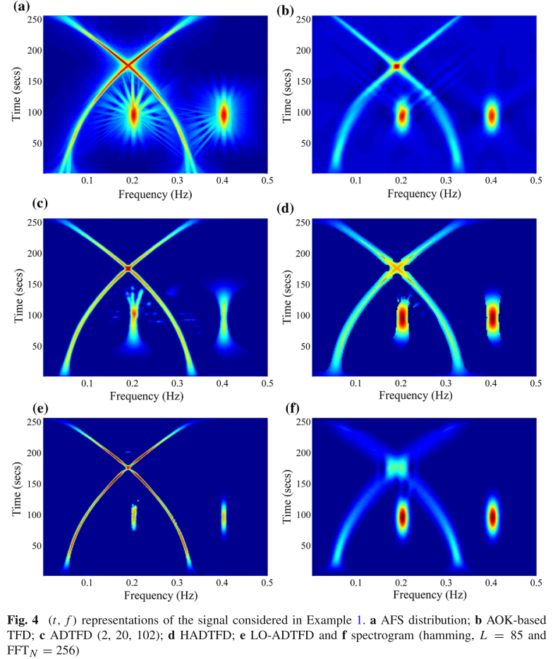
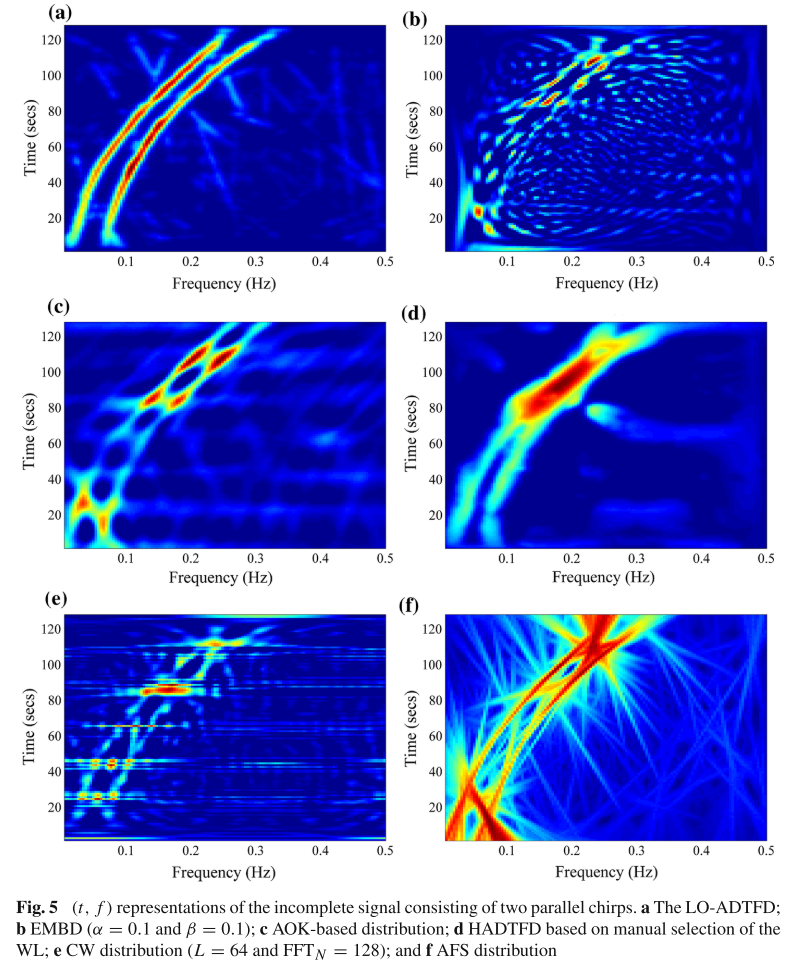
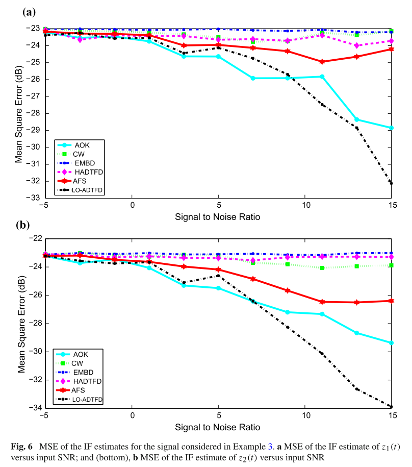
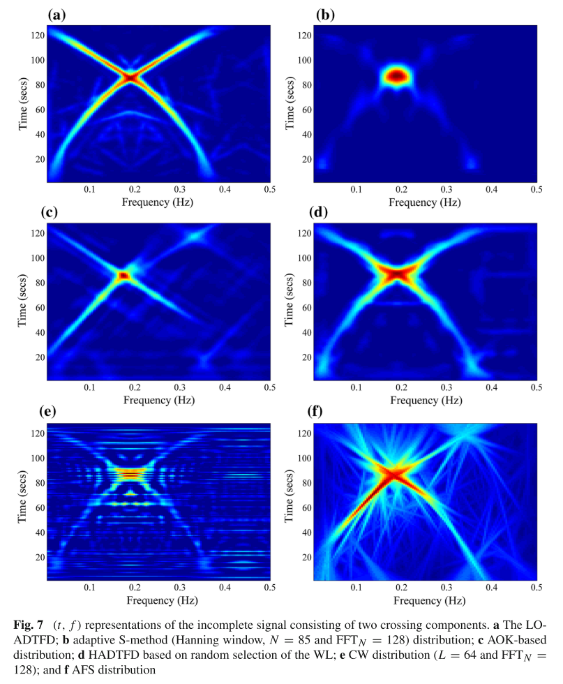

# Time-frequency distribution with local optimization and adaptive directional time-frequency distribution [with MATLAB code]

Introduction: Most actual signals are non-stationary and contain instantaneous frequency (IF) components, which specify the key physical parameters of the input signal. Analyzing signals in the (t, f) plane is more advantageous than considering them in time domain or frequency domain [29]. Time-frequency distribution (TFD) represents the energy distribution of a signal in two-dimensional time-frequency space [12, Chapter 4].

Typically, TFDs are divided into linear TFDs and quadratic TFDs (QTFDs). Short-time Fourier transforms, as linear time-frequency analysis methods, have advantages such as simplicity in computation and avoidance of cross-term interference. Linear time-frequency distributions are reversible [34], making them widely used for applications such as signal denoising and compression. The resolution performance of short-time Fourier transforms typically depends on the shape and size of the analysis window. A longer window leads to good frequency resolution, while a shorter window provides higher temporal resolution. For methods like wavelet transforms and S transforms, the width of the analysis window is inversely proportional to frequency, resulting in higher frequency resolution for low frequencies and higher temporal resolution for high frequencies, leading to more precise time resolution for both high and low frequencies. To achieve high energy concentration in both low and high frequencies, it is necessary to optimize the window length for each point on the time-frequency plane [5, 16, 24, 30, 45, 46].

QTFDs are another type of widely used TFDs because they simply represent the distribution of signal energy in the time-frequency plane. Moreover, to extract important parameters from linear TFDs (such as STFT), secondary TFDs are used. For QTFDs, the Wigner-Ville distribution (WVD) is a prototype distribution defined in time t and frequency f:
The z(t) obtained by performing a Hilbert transform on the real signal s(t) is the analytically related s(t). The WVD provides high resolution, but it suffers from cross-term interference from multicomponent and nonlinear frequency modulated signals [31]. Cross-terms have oscillatory characteristics that are typically reduced through low-pass filtering. The smoothing kernel can be either signal-related or signal-independent. Signal-independent categories include methods such as the separable kernel approach, for example, the Tight Support Kernel (TFD), and the extended modified B distribution, which provide improvements over those discussed in [14]. Recently, compression-sensing methods have been developed to further enhance the resolution of QTFD, at the cost of increased computational costs [2, 17, 22, 39, 43]. For signals that follow a specific direction away from the time axis in the (t, f) domain, it is important to employ directional smoothing to achieve high resolution TFD [8]. The direction of the smoothing kernel is usually estimated based on the properties of the fractional Fourier transform or the Radon transform [8, 13]. Global adaptive methods are only applicable to signals whose energy direction does not change with time. Time-varying adaptive kernels, such as the adaptive optimal kernel (AOK), realize a significant class of signals with higher resolution (t, f) representations. However, AOK adjusts the kernel direction at each moment; therefore, its performance degrades when signals have an uneven energy distribution along multiple directions in the (t, f) domain. For such signals, adaptive directional TFD (ADTFD) adapts the direction of the smoothing kernel at each point in a (t, f) to provide higher performance.
In almost all QTFDs, the trade-off between good resolution and crosstalk reduction is typically controlled by some parameters. These parameters are optimized manually or automatically through maximizing measures such as entropy, energy concentration, bandwidth-time product, Jones-Parks (JP) measure, and Renyi entropy ratio of norms [12, Ch.7] [7, 19, 21, 27, 28, 36 - 38, 40, 42, 44]. Based on the selected measures, exhaustive or efficient methods can be used to search for optimal parameters [4, 15, 42]. In recent studies, two methods to adjust ADTFD parameters have been proposed [4, 32]. However, both these methods focus on optimizing shape parameters while the length of the smooth kernel is manually adjusted. The method described in [4] performs global optimization for both a and B. Global optimization cannot achieve ideal energy concentration when signals consist of short time transients and closed components. This paper proposes an approach to optimize all parameters of ADTFD, including window length and shape parameters a and B at each (t, f) point. Therefore, the resulting distribution is referred to as Localized Optimization ADTFD (LO-ADTFD).

Conclusion - The method produces high-resolution TFDs that can suppress crosstalk while distinguishing close components and preserving the energy of short duration transients.
- The method can be applied to signal analysis with missing samples.
- Simulation and experimental results validate the effectiveness of the proposed method.
The proposed method is computationally expensive but has many inherent parallel algorithms that can be implemented using GPUs to reduce computation costs. The adaptive TFD is irreversible. Therefore, direct synthesis of signals is not possible. However, IF estimation methods combined with time-frequency filtering can be used to extract signal components [1].

## Images

<!-- PAYMENT_BLOCK -->

## Get this dataset

- Payment link (Stripe): [Buy now](https://buy.stripe.com/3cs8yP7sY87d0vu9AB)
- Payment QR code: 

<!-- /PAYMENT_BLOCK -->
